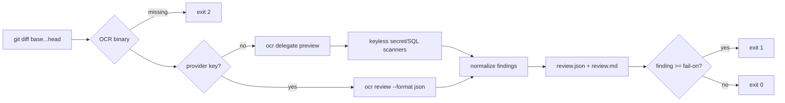

# minilab-ocr-scion-review

**Built by SkilledDragon LLC — architecture-led software engineering — [skilleddragon.com](https://skilleddragon.com)**

Palette: `#020617` / `#040F49` / `#006BDF` / `#00BFA6`

Scion-scale PR review gate: review agent-authored diffs with [Alibaba Open Code Review](https://github.com/alibaba/open-code-review) before merge, emit line-level findings, and fail closed on blocking severities.

| Piece | Purpose |
| --- | --- |
| `bun run review --base <ref> --head <ref>` | Gate CLI (keyless delegate path or LLM review) |
| `.claude/skills/ocr-merge-gate/` | Skill that requires exit 0 before merge |
| `upstream/` | git submodule pin of `alibaba/open-code-review` @ `v1.13.0` |
| `review.json` / `review.md` | Normalized findings |

Upstream pin: [alibaba/open-code-review](https://github.com/alibaba/open-code-review) @ `1672852136fc87748249d22bce0819f33419ea79` (tag `v1.13.0`, Apache-2.0) · npm [`@alibaba-group/open-code-review@1.13.0`](https://www.npmjs.com/package/@alibaba-group/open-code-review)

## What we built and why

Agent merge velocity is rising. Según Anthropic, merges went from about 2,500/day (May 2026) to 30,000+/day (Sep 2026); they built **Scion** (internal, not for general use) — see [Redesigning source control](https://www.anthropic.com/engineering/redesigning-source-control). This lab shows how a normal team keeps review quality at that velocity on plain git: pin Open Code Review, run a keyless deterministic gate on every agent PR, and optionally escalate to LLM review when provider keys exist.



## What we tested

Verified upstream commands at `1672852136fc87748249d22bce0819f33419ea79` via `.github/workflows/upstream-ci.yml` (verbatim steps from `ci/upstream/ci.yml` with allowed deviations A1–A3).

Lab suite:

```bash
bun install --frozen-lockfile
bun run ensure:ocr
bun run lint
bun run typecheck
bun test
bun run check:skills
bun run check:banned
bun run extract:upstream
bun run check:upstream-parity
```

Real pass counts, durations, and the CI run URL: [RESULTS.md](RESULTS.md).

## Setup

Requires Bun `1.4.3`, Node `>=24`, and a git client recent enough for OCR (2.39+ works; OCR warns below 2.41).

```bash
git clone --recurse-submodules https://github.com/SkilledDragonCorp/minilab-ocr-scion-review.git
cd minilab-ocr-scion-review
cp .env.example .env
bun install --frozen-lockfile
bun run ensure:ocr
```

Confirm the submodule pin:

```bash
git -C upstream rev-parse HEAD
# must print 1672852136fc87748249d22bce0819f33419ea79
```

## Tutorial

1. Create a feature branch with a risky change (hard-coded secret + SQL string concat).
2. Run the gate against `main`:

```bash
bun run review --base origin/main --head HEAD --fail-on high --keyless
```

3. Expected: exit code `1`, `review.json` lists findings on the exact added lines, `review.md` summarizes them.
4. Fix the findings, re-run until exit code `0`.
5. With `GEMINI_API_KEY` set, omit `--keyless` to run LLM review through OCR.

## Using these skills in Claude Code and Cursor

- **Claude Code** auto-discovers `.claude/skills/ocr-merge-gate/SKILL.md`. Invoke by asking the agent to run the **ocr-merge-gate** skill before merge.
- **Cursor** loads the same `.claude/skills` folder. Invoke **ocr-merge-gate** by name in Agent chat when finishing a change.

## API keys

| Variable | Required | Where | Used by |
| --- | --- | --- | --- |
| _(none)_ | for keyless gate | — | `bun test`, CI `test` job |
| `GEMINI_API_KEY` | optional | Google AI Studio | live LLM review / `live.review.test.ts` |
| `ANTHROPIC_API_KEY` | optional | Anthropic console | live LLM review |
| `OPENAI_API_KEY` | optional | OpenAI | `--provider openai` |
| `OPENAI_RESPONSES_API_KEY` | optional | OpenAI | Responses API provider |
| `OPENROUTER_API_KEY` | optional | OpenRouter | `--provider openrouter` |
| `DASHSCOPE_API_KEY` | optional | Alibaba DashScope | `--provider dashscope` |
| `AWS_REGION` + `AWS_PROFILE` | optional | AWS | `--provider bedrock` |
| `OCR_DELEGATE_REQUIRE_PTY` | CI-only non-secret | set to `1` in upstream test job | upstream Go tests |
| `OCR_BINARY` | optional | local path override | lab CLI |
| `OCR_ENABLE_TELEMETRY` | opt-out | unset or not `1` | OCR telemetry off |
| `OCR_LLM_*` | optional | OCR custom endpoint | upstream LLM resolver |
| `OTEL_*` / `TRACEPARENT` | optional | OTLP | only when telemetry enabled |
| `DO_NOT_TRACK` | optional | `1` in CI | general telemetry hygiene |

Mirror empty values in `.env.example`.

## License

- Lab code: MIT (SkilledDragon LLC)
- Upstream Open Code Review: Apache-2.0 (Alibaba Group)
